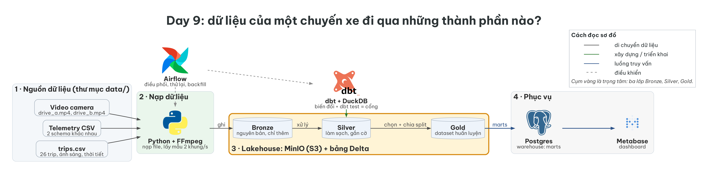
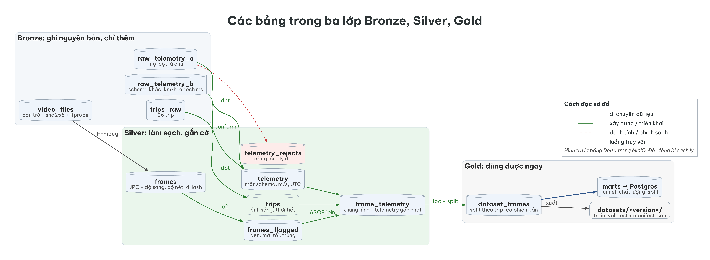
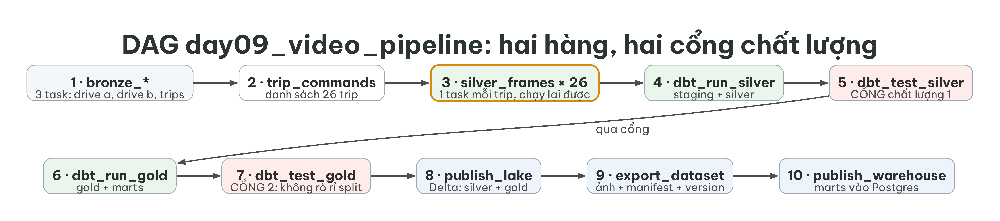

# Lab Day 9 — Vận hành một data pipeline end-to-end cho video và telemetry xe tự lái

> Track 4 · Ngày 9 · *Data pipeline cho Computer Vision và Robotics* · thời lượng **4 giờ** · **bài cá nhân**
> Pipeline đã được dựng **sẵn và chạy được**. Việc của bạn: **tải dữ liệu, đặt đúng chỗ, chạy từng cấu phần, kiểm tra kết quả từng phần, làm vài thí nghiệm, và viết báo cáo giải thích điều bạn thấy.** Bạn **không phải viết mã**.

| File | Dùng để làm gì |
|---|---|
| `README.md` (file này) | Bức tranh toàn hệ thống, nguồn dữ liệu, kỳ vọng, cách chạy, cách nộp |
| [`GUIDE.md`](GUIDE.md) | Hướng dẫn từng bước: chạy, quan sát, thí nghiệm, câu hỏi |
| [`REPORT.md`](REPORT.md) | **Mẫu báo cáo** bạn điền (10 câu hỏi) |
| [`RUBRIC.md`](RUBRIC.md) | Thang điểm 100 và cách chấm |
| `scripts/lab.sh` | Lệnh ngắn: `step`, `exp`, `verify`, `cli`, `dbt` |
| `scripts/check_data.py`, `scripts/check_submission.py` | Kiểm tra dữ liệu đã đặt đúng chỗ; kiểm tra bài trước khi nộp |
| `pipeline/`, `dbt/`, `dags/`, `docker-compose.yml` | Mã nguồn của pipeline (để **đọc**, không cần sửa) |

---

## 1. Mục tiêu học tập

Sau bài lab, bạn có thể:

1. Chạy và vận hành một pipeline đủ các giai đoạn của slide Day 9: **ingestion → bronze → silver → quality gate → gold → warehouse → dashboard**, và kiểm tra kết quả của từng giai đoạn.
2. Giải thích và **chứng minh bằng số** tính **idempotent**: chạy lại một partition không nhân đôi dữ liệu.
3. Giải thích cách pipeline xử lý **schema drift** và **lệch đồng hồ** giữa hai nguồn telemetry, và vì sao dòng lỗi vào **quarantine** thay vì bị xoá.
4. Phân biệt test `error` (dừng pipeline) với `warn` (chỉ báo), và thấy cổng chất lượng bắt lỗi khi một luật bị nới.
5. Chứng minh bằng thí nghiệm vì sao phải chia dataset **theo trip (cảnh)**, không theo khung hình (**leakage**).
6. Đọc **phiên bản dataset (`dataset_version`)** và **lineage**; vận hành lại một **task bị sập** trong Airflow.

## 2. Toàn hệ thống

### 2.1 Bức tranh tổng thể

*Câu hỏi: dữ liệu của một chuyến xe đi qua những thành phần nào?*



Cụm màu vàng là trọng tâm: ba lớp **Bronze, Silver, Gold** nằm trong MinIO (object storage, giao diện S3), mỗi bảng là một **bảng Delta** (có commit, có time travel). **dbt + DuckDB** biến đổi dữ liệu và chạy test; **Airflow** điều phối; **Postgres** là warehouse cho **Metabase**.

| Thành phần | Công cụ | Slide Day 9 |
|---|---|---|
| Object storage | MinIO (S3 API) | 17 |
| Lakehouse, time travel | Delta Lake | 16, 19 |
| Medallion | Bronze, Silver, Gold | 14, 20 |
| ELT và quality | DuckDB + dbt (tests) | 22, 28 |
| Xử lý video | FFmpeg, lấy mẫu 2 khung/giây | 24 |
| Orchestration | Airflow | 26, 27 |
| Warehouse, BI | Postgres, Metabase | 16 |
| Version hoá, lineage | `dataset_version`, `manifest.json` | 30, 31 |
| Chia split theo cảnh | split theo trip | 35 |

### 2.2 Các bảng trong ba lớp

*Câu hỏi: bảng nào nằm ở lớp nào, và dòng lỗi đi đâu?*



- **Bronze**: ghi nguyên bản, chỉ thêm. Mỗi nguồn telemetry một bảng riêng vì schema khác nhau.
- **Silver**: một schema thống nhất (m/s, độ, UTC). Dòng lỗi **không bị xoá im lặng**: chúng vào `telemetry_rejects` kèm lý do. Mỗi khung hình có cờ chất lượng (đen, mờ, tối, trùng) và được nối với telemetry gần nhất theo event time.
- **Gold**: `dataset_frames` (split theo trip, có phiên bản), thư mục ảnh `datasets/<version>/{train,val,test}/` kèm `manifest.json`, và các **mart** nạp vào Postgres.

### 2.3 DAG Airflow

*Câu hỏi: pipeline chạy theo thứ tự nào, và test lỗi dừng ở đâu?*



Hộp đỏ là **dbt test**. Nếu test `error`, các task phía sau không chạy: dữ liệu xấu không đi tiếp. `silver_frames` chạy **một task cho mỗi trip** (26 task), nên một trip hỏng có thể chạy lại riêng.

## 3. Nguồn dữ liệu và cách đặt đúng chỗ

Dữ liệu cắt từ bộ **L2D-v3** của Yaak (giấy phép **Apache 2.0**), ghi bằng một chiếc **KIA Niro EV 2023**: 10 000 episode, 10 fps, 7 camera, 479 GB cho toàn bộ.

| | Liên kết |
|---|---|
| Trang bộ dữ liệu gốc | https://huggingface.co/datasets/yaak-ai/L2D-v3 |
| Video camera trước trái | `videos/observation.images.front_left/chunk-000/file-000.mp4` |
| Bảng episode (thời điểm trong video) | `meta/episodes/chunk-000/file-000.parquet` |
| Telemetry theo khung hình | `data/chunk-000/file-000.parquet` … `file-003.parquet` |
| Định dạng LeRobot v3 | https://huggingface.co/docs/lerobot/lerobot-dataset-v3 |
| **Gói dữ liệu của lab** (`day09-data.zip`, 28 MB) | nằm sẵn trong repo này: **`dataset/day09-data.zip`** · tải trực tiếp: https://github.com/VinUni-AI20k/K4-L3L4-Track4-DataPipeline4ComputerVision/raw/main/dataset/day09-data.zip |

Bạn **không cần tải bộ L2D-v3 gốc** (479 GB): giảng viên đã cắt hai đoạn video khoảng 5 phút (đọc theo byte range) và đóng gói thành `day09-data.zip`.

**Đặt dữ liệu đúng chỗ (2 bước):**

```bash
# 1. Giải nén NGAY TẠI thư mục gốc của lab (zip đã chứa sẵn thư mục data/):
unzip dataset/day09-data.zip
# 2. Kiểm tra: mọi file phải báo ĐÚNG
python3 scripts/check_data.py
```

File zip nằm sẵn trong repo của lớp. Khi bạn copy thư mục lab sang **repo riêng** để nộp bài, zip và dữ liệu **không** được đưa lên (đã có trong `.gitignore`); `check_submission.py` báo FAIL nếu bạn lỡ commit chúng.

Nếu chỉ có mỗi thư mục lab mà không có file zip, dùng `python3 scripts/fetch_data.py`: nó tải từ đường dẫn trong `data/MANIFEST.json`, tự kiểm tra sha256 và giải nén. Phương án dự phòng khi không tải được: `python3 scripts/build_data.py` tự dựng từ nguồn công khai (cần `python3`, `numpy`, `pyarrow`, `ffmpeg`, mạng, khoảng 5 phút; số liệu có thể lệch nhẹ vài khung hình so với bản chuẩn).

| File trong `data/` | Nội dung |
|---|---|
| `drive_a.mp4`, `drive_b.mp4` | Hai chuyến, mỗi chuyến 13 trip nối tiếp, 640×360, 10 fps |
| `telemetry_a.csv` | Tốc độ **m/s**, hướng độ, timestamp ISO UTC |
| `telemetry_b.csv` | **Schema khác**: tên cột khác, tốc độ **km/h**, timestamp **epoch ms**, bàn đạp theo %, đồng hồ thiết bị **lệch** so với video |
| `trips.csv` | Bảng metadata: mỗi dòng một trip (giờ bắt đầu, kết thúc, ánh sáng, thời tiết) |
| `sources.json` | Manifest ingest: file nào, đơn vị, độ lệch đồng hồ đã khai báo |

Điều cần biết về dữ liệu:

- **Thật**: video, tốc độ, hướng, GPS, gia tốc, bàn đạp, góc lái, ánh sáng, thời tiết.
- **Dựng lại**: trục thời gian. Các episode gốc là những chuyến khác nhau, nên mỗi "drive" là 13 trip nối tiếp trên một đồng hồ liên tục.
- **Có lỗi được cấy vào** để pipeline có việc làm: video bị đen, mờ, đứng hình, thiếu sáng; telemetry bị trùng, thiếu, giá trị vô lý, sai thứ tự. Bạn sẽ **tự thấy** pipeline phát hiện và xử lý từng loại.

## 4. Kỳ vọng của bài lab

**Bạn làm**: chạy pipeline và kiểm tra từng cấu phần (`scripts/lab.sh step 1` … `step 5`), làm 4 thí nghiệm ngắn, chạy DAG trong Airflow, làm bài tập "task bị sập rồi chạy lại", xem dashboard Metabase, rồi **viết `REPORT.md`** (10 câu hỏi) giải thích những gì bạn thấy bằng **số liệu của chính bạn**.

**Kết quả cuối cùng phải đạt:**

- `scripts/lab.sh verify` báo **27/27** kiểm tra đạt, và `scripts/lab.sh step all` đạt cả năm bước.
- DAG `day09_video_pipeline` chạy **xanh toàn bộ** trong Airflow.
- Bốn file bằng chứng trong `report/evidence/` (từ 4 thí nghiệm) cùng `run_summary.json`.
- Ba ảnh chụp màn hình và `REPORT.md` đã điền.

**Mỗi người một kết quả riêng.** Bạn đặt **MSSV** vào file `.env` (`LAB_STUDENT_ID=<MSSV>`). MSSV được trộn vào cách xếp trip để chia train/val/test, nên **mỗi người có split, số khung hình mỗi split và `dataset_version` khác nhau**. Giảng viên chạy lại bài của bạn với MSSV của bạn và đối chiếu `dataset_version`.

**Thời gian gợi ý (240 phút):**

| Phút | Nội dung |
|---|---|
| 0–30 | Chuẩn bị: tải dữ liệu và image, `.env`, khởi động Docker |
| 30–50 | Bước 1 · Bronze |
| 50–85 | Bước 2 · Silver telemetry + thí nghiệm "phá cổng chất lượng" |
| 85–130 | Bước 3 · Silver frames + thí nghiệm "idempotent" và "ngưỡng khung trùng" |
| 130–140 | Nghỉ |
| 140–170 | Bước 4 · Gold + thí nghiệm "rò rỉ split" |
| 170–210 | Bước 5 · Warehouse, DAG Airflow, bài tập sập và chạy lại, Metabase |
| 210–240 | Viết báo cáo và nộp |

### 4.1 Làm việc cá nhân và nộp bài qua repo công khai

Đây là **bài cá nhân**. Bạn có thể trao đổi ý tưởng với bạn bè, nhưng **báo cáo, số liệu và ảnh chụp phải là của bạn**. Repo công khai nên giảng viên **so khớp bài giữa các repo** và đối chiếu với **lịch sử commit**; chép bài bị 0 điểm cho cả hai bên.

1. Trên GitHub tạo một repo **Public** trống (gợi ý tên `ai20k-day09-<mssv>`).
2. Lấy thư mục lab về, đặt **trong thư mục home** của máy, rồi: `git init`, `git remote add origin <url repo của bạn>`, commit đầu tiên (`git commit -m "chore: nhận đề lab day 9"`).
3. **Sau mỗi bước, commit và push** với thông điệp nêu số bước, ví dụ `Bước 2: silver telemetry, thí nghiệm phá cổng`. Cần **ít nhất 5 commit**.
4. Trước khi nộp:

```bash
python3 scripts/check_submission.py --save-verify     # chạy verify và lưu report/verify.txt
python3 scripts/check_submission.py                   # sửa mọi mục FAIL
git add -A && git commit -m "chore: bài nộp cuối" && git push
```

5. Nộp **đường dẫn repo** theo kênh giảng viên chỉ định. Repo phải ở chế độ **Public** lúc chấm; giảng viên chấm trên commit mới nhất **trước hạn nộp**.

Khi công khai repo:

- **Không đưa vào repo**: dữ liệu `data/*.mp4|csv` (đã có `.gitignore`), thư mục `work/`, file `.tar`, `.duckdb`.
- Mật khẩu mặc định của lab (`admin`, `minioadmin`...) chỉ dùng cho môi trường cục bộ, không phải bí mật, nhưng **đừng** commit khoá hay token thật.
- **Không sửa** `tests/`, `pipeline/verify.py`, `docker-compose.yml`: giảng viên chấm bằng bản gốc của các file này.

## 5. Yêu cầu máy

- **Docker Desktop** (Compose v2). **RAM cấp cho Docker ≥ 6 GB** (Settings → Resources). Đo thực tế: Airflow + MinIO + Postgres ≈ 1,9 GB, thêm Metabase ≈ 3,1 GB; máy 8 GB RAM nên bật Metabase sau cùng.
- Ổ đĩa trống ≈ 8 GB (image Docker ≈ 5 GB).
- **Đặt thư mục lab trong thư mục home**, không đặt trên ổ ngoài: Docker Desktop trên macOS đôi khi mất kết nối với ổ ngoài (`mkdir /host_mnt/Volumes/...: file exists`).
- Lần đầu cần mạng để kéo image (≈ 5 GB). **Hãy kéo trước giờ học**: `scripts/prepare_images.sh`, hoặc nạp từ `day09-images.tar` do giảng viên phát: `docker load -i day09-images.tar`.

## 6. Chạy nhanh

```bash
cp .env.example .env            # rồi mở .env và đặt LAB_STUDENT_ID=<MSSV của bạn>
python3 scripts/check_data.py   # dữ liệu đã đặt đúng chỗ chưa?
docker compose --profile orchestrate up -d --build      # MinIO, Postgres, Airflow
# Airflow : http://localhost:8080   (admin / admin)
# MinIO   : http://localhost:9001   (minioadmin / minioadmin), bucket `lake`
scripts/lab.sh step all --reset    # chạy cả năm bước, mỗi bước in kết quả và tự kiểm tra (≈ 2 phút)
```

Khi `step all` đạt, chuyển sang [`GUIDE.md`](GUIDE.md): bạn sẽ chạy **lại từng bước** để đọc kết quả kỹ hơn và làm các thí nghiệm. Metabase (sau cùng):

```bash
docker compose --profile bi up -d       # http://localhost:3000
python3 scripts/setup_metabase.py       # in ra đường dẫn dashboard và tài khoản đăng nhập
```

Lệnh ngắn trong `scripts/lab.sh`:

| Lệnh | Việc |
|---|---|
| `scripts/lab.sh step <1..5\|all> [--reset]` | chạy từng cấu phần, in kết quả, kiểm tra |
| `scripts/lab.sh exp <tên>` | thí nghiệm: `idempotency`, `break-gate`, `leakage`, `threshold` |
| `scripts/lab.sh verify [--module N]` | 27 kiểm tra tự động, chia theo 5 module |
| `scripts/lab.sh cli sql "select ..."` | truy vấn mọi bảng Delta (`lake.<lớp>_<tên>`) và bảng dbt |
| `scripts/lab.sh cli history silver.frames` | lịch sử commit của một bảng Delta (time travel) |
| `scripts/lab.sh test` | unit test của hàm xử lý khung hình |

## 7. Cấu trúc thư mục

```
Day9-lab/
├── README.md  GUIDE.md  RUBRIC.md  REPORT.md
├── .env.example                MSSV của bạn (sao chép thành .env)
├── dataset/day09-data.zip      gói dữ liệu (chỉ có trong repo của lớp)
├── data/                       MANIFEST.json + dữ liệu bạn giải nén vào
├── report/evidence/            bằng chứng tự ghi ra từ các thí nghiệm
├── report/screenshots/         ảnh chụp bạn nộp (airflow_graph.png, minio_lake.png, metabase_dashboard.png)
├── pipeline/                   mã Python: bronze, frames, publish, steps, experiments, verify
├── dbt/models/                 staging, silver, gold, marts + schema.yml (tests)
├── dags/day09_video_pipeline.py    DAG Airflow
├── scripts/                    lab.sh, check_data.py, check_submission.py, setup_metabase.py
├── docker-compose.yml          MinIO, Postgres, Airflow, Metabase
└── docs/diagrams/              ba sơ đồ trong tài liệu này
```

## 8. Sự cố thường gặp

| Triệu chứng | Nguyên nhân và cách xử lý |
|---|---|
| `check_data.py` báo THIẾU | Chưa chạy `unzip dataset/day09-data.zip` ở thư mục gốc lab, hoặc giải nén sai chỗ: `data/drive_a.mp4` phải nằm ngay trong thư mục `data/` của lab. |
| `mkdir /host_mnt/Volumes/...: file exists` | Thư mục lab nằm trên ổ ngoài. Chuyển vào thư mục home, hoặc khởi động lại Docker Desktop. |
| Airflow chưa vào được sau khi `up` | Cần 1–2 phút để khởi tạo; chờ `healthy` ở `docker compose ps`. |
| Cổng 5432 bị chiếm | Postgres của lab mở ở cổng **5433** trên máy bạn (bên trong Docker vẫn là 5432). |
| `step` báo "chưa đặt LAB_STUDENT_ID" | Bạn chưa tạo `.env`. Sau khi sửa `.env`, chạy `docker compose --profile orchestrate up -d` để áp dụng. |
| Kéo image rất chậm | Kéo ở nơi có mạng tốt, hoặc dùng `docker load -i day09-images.tar`. |
| Muốn làm lại từ đầu | `scripts/lab.sh step all --reset`, hoặc chạy DAG `day09_reset` trong Airflow. |

Tài liệu đọc thêm: slide Day 9 (slide 12–40); Reis & Housley, *Fundamentals of Data Engineering* (chương 2, 6, 7); tài liệu Delta Lake, dbt (data tests), Apache Airflow (dynamic task mapping).
